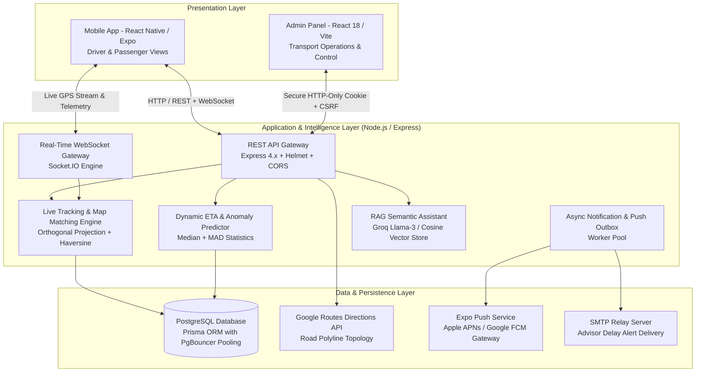

# Technical Architecture, Mathematical Models & Algorithms Guide
**College Bus Tracking System**

This document serves as the authoritative technical reference for the architecture, mathematical formulations, algorithms, cryptographic standards, and protocol specifications implemented throughout the College Bus Tracking System.

---

## Table of Contents
1. [High-Level System Architecture](#1-high-level-system-architecture)
2. [End-to-End Real-Time Data Pipeline](#2-end-to-end-real-time-data-pipeline)
3. [Core Algorithms & Mathematical Models](#3-core-algorithms--mathematical-models)
   - 3.1 [Haversine Great-Circle Distance Algorithm](#31-haversine-great-circle-distance-algorithm)
   - 3.2 [Orthogonal Vector Projection & Cross-Track Map Matching](#32-orthogonal-vector-projection--cross-track-map-matching)
   - 3.3 [Median & Median Absolute Deviation (MAD) Robust Outlier Detection](#33-median--median-absolute-deviation-mad-robust-outlier-detection)
   - 3.4 [Dynamic Multi-Factor ETA Prediction with Traffic Smoothing](#34-dynamic-multi-factor-eta-prediction-with-traffic-smoothing)
   - 3.5 [Geofence Proximity & Finite State Machine (FSM)](#35-geofence-proximity--finite-state-machine-fsm)
   - 3.6 [Vector Cosine Similarity (Semantic AI Assistant)](#36-vector-cosine-similarity-semantic-ai-assistant)
   - 3.7 [Adaptive Dynamic Rate GPS Sampling](#37-adaptive-dynamic-rate-gps-sampling)
4. [Cryptographic Standards & Security Specifications](#4-cryptographic-standards--security-specifications)
   - 4.1 [SHA-256 Cryptographic Hash Chaining (Audit Ledger)](#41-sha-256-cryptographic-hash-chaining-audit-ledger)
   - 4.2 [Bcrypt Password Key Derivation](#42-bcrypt-password-key-derivation)
   - 4.3 [JWT & Ephemeral Driver Authentication](#43-jwt--ephemeral-driver-authentication)
   - 4.4 [HTTP-Only, Strict-Cookie Admin Sessions with CSRF Defense](#44-http-only-strict-cookie-admin-sessions-with-csrf-defense)
5. [Distributed Systems, Concurrency & Networking Protocols](#5-distributed-systems-concurrency--networking-protocols)
   - 5.1 [Pessimistic Concurrency (`SELECT ... FOR UPDATE SKIP LOCKED`)](#51-pessimistic-concurrency-select--for-update-skip-locked)
   - 5.2 [Exponential Backoff with Jitter for Notification Delivery](#52-exponential-backoff-with-jitter-for-notification-delivery)
   - 5.3 [WebSockets (Socket.IO) Live Broadcast Engine](#53-websockets-socketio-live-broadcast-engine)
   - 5.4 [SMTP (Simple Mail Transfer Protocol) Advisor Dispatch](#54-smtp-simple-mail-transfer-protocol-advisor-dispatch)
6. [Summary Cheat Sheet for Technical Viva / Interviews](#6-summary-cheat-sheet-for-technical-viva--interviews)

---

## 1. High-Level System Architecture

The system uses a distributed **Three-Tier Micro-Modular Architecture**:



---

## 2. End-to-End Real-Time Data Pipeline

1. **Driver Telemetry:** The driver’s mobile device acquires raw GNSS fixes $(\text{latitude}, \text{longitude}, \text{speed}, \text{heading}, \text{accuracy}, \text{timestamp})$.
2. **Adaptive Filtering:** [adaptiveGpsPolicy.js](file:///e:/bus-tracking-system/backend/src/lib/adaptiveGpsPolicy.js) throttles transmission between $0\text{s}$ and $30\text{s}$ based on motion state.
3. **Ingestion & Sanity Filtering:** [liveTracking.js](file:///e:/bus-tracking-system/backend/src/lib/liveTracking.js) enforces temporal checks ($<5\text{m}$ age, no future skew), accuracy filters ($<200\text{m}$), and velocity checks ($<120\text{ km/h}$).
4. **Map-Matching:** The coordinate is projected orthogonally onto scheduled road polyline segments to compute cross-track deviation.
5. **Geofence State Evaluation:** Checks radial proximity ($150\text{m}$) against ordered route stops and updates sequence events.
6. **Multi-Factor ETA Update:** Dynamic ETA is recalculated using rolling velocity and historical median segment durations.
7. **Broadcast & Push Outbox:** The state is pushed via Socket.IO to passenger devices in under $50\text{ms}$. If delays breach $09:45\text{ AM}$, class advisors receive automated SMTP notifications.

---

## 3. Core Algorithms & Mathematical Models

### 3.1 Haversine Great-Circle Distance Algorithm
* **Location:** [`backend/src/lib/haversine.js`](file:///e:/bus-tracking-system/backend/src/lib/haversine.js)
* **Problem:** Earth is an oblate spheroid. A degree of longitude shrinks towards the poles ($\Delta \lambda \cdot \cos \phi$), so Euclidean distance ($d = \sqrt{\Delta x^2 + \Delta y^2}$) causes severe errors.
* **Mathematical Formulation:**
  $$\phi_1 = \text{lat}_1 \cdot \frac{\pi}{180}, \quad \phi_2 = \text{lat}_2 \cdot \frac{\pi}{180}$$
  $$\Delta \phi = (\text{lat}_2 - \text{lat}_1) \cdot \frac{\pi}{180}, \quad \Delta \lambda = (\text{lon}_2 - \text{lon}_1) \cdot \frac{\pi}{180}$$
  $$a = \sin^2\left(\frac{\Delta \phi}{2}\right) + \cos(\phi_1)\cos(\phi_2)\sin^2\left(\frac{\Delta \lambda}{2}\right)$$
  $$c = 2 \cdot \operatorname{atan2}\left(\sqrt{a}, \sqrt{1 - a}\right)$$
  $$d = R \cdot c$$
  Where $R = 6{,}371{,}000\text{ meters}$ (mean volumetric Earth radius).
* **Usage:** Calculates distances between buses and boarding stops, driver proximity, and speed calculations between successive GPS samples.

---

### 3.2 Orthogonal Vector Projection & Cross-Track Map Matching
* **Location:** [`backend/src/lib/liveTracking.js`](file:///e:/bus-tracking-system/backend/src/lib/liveTracking.js#L68-L100)
* **Problem:** Raw GPS points drift off the road. The system must verify if the bus is adhering to the authorized route or has deviated.
* **Mathematical Formulation:**
  For a GPS point $P$ and road segment bounded by stops $A$ and $B$, convert coordinates to local tangential Cartesian coordinates:
  $$x = (\lambda - \lambda_0) \cdot \frac{\pi}{180} \cdot R \cdot \cos\left(\phi_0 \cdot \frac{\pi}{180}\right)$$
  $$y = (\phi - \phi_0) \cdot \frac{\pi}{180} \cdot R$$
  Compute vector displacement $\vec{d} = B - A$ and point vector $\vec{v} = P - A$. The projection parameter $t$ clamped to segment $[0, 1]$ is:
  $$t = \operatorname{clamp}\left( \frac{\vec{v} \cdot \vec{d}}{\|\vec{d}\|^2}, \, 0, \, 1 \right) = \operatorname{clamp}\left( \frac{v_x d_x + v_y d_y}{d_x^2 + d_y^2}, \, 0, \, 1 \right)$$
  The projected snapped point is $P_{\text{proj}} = A + t \cdot \vec{d}$.
  The perpendicular cross-track distance is:
  $$\text{CrossTrackDistance} = \|P - P_{\text{proj}}\| = \sqrt{(P_x - P_{\text{proj},x})^2 + (P_y - P_{\text{proj},y})^2}$$
* **Thresholds:**
  * $\text{CrossTrackDistance} \le 2{,}000\text{ m}$: `ON_ROUTE`
  * $\text{CrossTrackDistance} > 2{,}000\text{ m}$: `OFF_ROUTE` triggered, warning passengers of deviation.

---

### 3.3 Median & Median Absolute Deviation (MAD) Robust Outlier Detection
* **Location:** [`backend/src/lib/segmentStatistics.js`](file:///e:/bus-tracking-system/backend/src/lib/segmentStatistics.js)
* **Problem:** Arithmetic mean ($\bar{x} = \frac{1}{n}\sum x_i$) and standard deviation ($\sigma$) are vulnerable to extreme outliers. A single $45$-minute accident or road blockage would distort regular ETA baselines for days.
* **Mathematical Formulation:**
  1. **Median ($M$):**
     $$M = \operatorname{median}(X)$$
  2. **Median Absolute Deviation (MAD):**
     $$\operatorname{MAD} = \operatorname{median}\left( \left| X_i - M \right| \right)$$
  3. **Modified $Z$-score Analog:**
     $$\text{scale} = \max(\operatorname{MAD}, 60\text{s})$$
     $$\text{DeviationScore} = \frac{|t_{\text{current}} - M|}{\text{scale}}$$
  4. **Disruption Classification Condition:**
     $$\text{IsDisruption} = t_{\text{current}} > M + \max(3 \cdot \text{scale}, M)$$
* **Usage:** Filters historical segment travel durations. Only travel times with normal distribution characteristics are stored in recurring baseline tables, while traffic disruptions are flagged separately.

---

### 3.4 Dynamic Multi-Factor ETA Prediction with Traffic Smoothing
* **Location:** [`backend/src/lib/eta.js`](file:///e:/bus-tracking-system/backend/src/lib/eta.js)
* **Algorithm Pipeline:**
  1. **Velocity Windowing:** Samples the last $k=10$ GPS fixes ($p_1, \dots, p_k$) over observation span $\Delta T$:
     $$v_{\text{live}} = \frac{\sum_{i=1}^{k-1} \operatorname{Haversine}(p_i, p_{i+1})}{\sum_{i=1}^{k-1} (t_{i+1} - t_i)}$$
  2. **Stationary Damping:** If cumulative displacement $<10\text{ m}$ for $\ge 30\text{ s}$, velocity is clamped to $0\text{ km/h}$ (`moving = false`).
  3. **Multi-Factor Segment Duration:**
     $$T_{\text{segment}} = \begin{cases}
     \max(T_{\text{live}}, T_{\text{historical}}), & \text{if moving = true and historical data exists} \\
     T_{\text{historical}}, & \text{if moving = false/unknown and historical data exists} \\
     T_{\text{live}}, & \text{if historical data missing}
     \end{cases}$$
  4. **Confidence-Bounded Range ($\operatorname{Range}(T)$):**
     * **High Confidence ($\ge 5$ fixes, historical match):** $\pm 15\%$
     * **Medium Confidence:** $\pm 25\%$
     * **Low Confidence ($<3$ fixes or unclassified speeds):** $\pm 40\%$
     $$\text{ETAMin} = \max\left(0, \lfloor T - \text{margin}\rfloor\right), \quad \text{ETAMax} = \lceil T + \text{margin}\rceil$$

---

### 3.5 Geofence Proximity & Finite State Machine (FSM)
* **Location:** [`backend/src/lib/stopAlerts.js`](file:///e:/bus-tracking-system/backend/src/lib/stopAlerts.js), [`liveTracking.js`](file:///e:/bus-tracking-system/backend/src/lib/liveTracking.js)
* **Geofence Radii:**
  * $\text{Radius}_{\text{Arrival}} = 150\text{ meters}$
  * $\text{Radius}_{\text{Approach}} = 500\text{ meters}$
* **Sequence Monotonicity:** Buses visit stops in strictly increasing sequence order $[s_1, s_2, \dots, s_n]$. If a bus enters $\text{Radius}(s_{k+1})$ while $s_k$ has not triggered, $s_k$ transitions to `POSSIBLY_SKIPPED` rather than stalling the pipeline.

---

### 3.6 Vector Cosine Similarity (Semantic AI Assistant)
* **Location:** [`backend/src/lib/vectorStore.js`](file:///e:/bus-tracking-system/backend/src/lib/vectorStore.js), [`ragAssistant.js`](file:///e:/bus-tracking-system/backend/src/lib/ragAssistant.js)
* **Mathematical Formulation:**
  For query vector $\vec{q}$ and document embedding vector $\vec{d}$ in $\mathbb{R}^{1536}$:
  $$\operatorname{CosineSimilarity}(\vec{q}, \vec{d}) = \frac{\vec{q} \cdot \vec{d}}{\|\vec{q}\|_2 \|\vec{d}\|_2} = \frac{\sum_{i=1}^{n} q_i d_i}{\sqrt{\sum_{i=1}^{n} q_i^2} \sqrt{\sum_{i=1}^{n} d_i^2}}$$
* **Threshold & Ranking:**
  * Matches filtered by $\operatorname{CosineSimilarity} \ge 0.75$.
  * Results sorted descending by score to assemble context for Groq Llama-3 generation.

---

### 3.7 Adaptive Dynamic Rate GPS Sampling
* **Location:** [`backend/src/lib/adaptiveGpsPolicy.js`](file:///e:/bus-tracking-system/backend/src/lib/adaptiveGpsPolicy.js)
* **Decision Matrix:**

| Vehicle State | Detection Condition | Transmission Interval | Battery / Bandwidth Benefit |
| :--- | :--- | :--- | :--- |
| **Immediate Event** | `TRIP_START`, `TRIP_END`, `RECONNECT`, `GPS_RECOVERED` | **$0\text{ s}$ (Instant)** | Guarantees zero latency on trip phase changes |
| **Approaching Stop** | Distance to next stop $\le 500\text{ m}$ | **$7\text{ s}$** | High precision arrival and departure detection |
| **Normal Cruising** | Moving at normal speeds on corridor | **$12\text{ s}$** | Optimal balance between tracking fluidity and data |
| **Sustained Stationary**| Speed $\approx 0\text{ km/h}$ for $\ge 30\text{ s}$ | **$30\text{ s}$** | Prevents battery drain at signals, jams, and terminal |

---

## 4. Cryptographic Standards & Security Specifications

### 4.1 SHA-256 Cryptographic Hash Chaining (Audit Ledger)
* **Standard:** FIPS PUB 180-4 (Secure Hash Standard, SHA-256)
* **Location:** [`backend/src/lib/hashChain.js`](file:///e:/bus-tracking-system/backend/src/lib/hashChain.js), [`adminAudit.js`](file:///e:/bus-tracking-system/backend/src/lib/adminAudit.js)
* **Implementation:**
  Every late-arrival alert and admin audit log record forms an append-only cryptographic hash chain:
  $$\text{RecordHash}_k = \operatorname{SHA-256}\left(\operatorname{CanonicalJSON}(R_k) \,\|\, \text{PreviousHash}_{k-1}\right)$$
  $$\operatorname{CanonicalJSON}(R) \implies \text{Keys recursively sorted alphabetically, ISO-8601 UTC dates, zero whitespace}$$
* **Tamper-Evident Verification:**
  `verifyChain(rows)` recomputes hashes from row $1$ to $n$. If a database record is modified in PostgreSQL, its hash mismatch breaks all subsequent links in the chain, exposing tampering.

### 4.2 Bcrypt Password Key Derivation
* **Standard:** OpenBSD Blowfish password hashing (RFC-compliant)
* **Location:** [`backend/src/lib/adminSessions.js`](file:///e:/bus-tracking-system/backend/src/lib/adminSessions.js)
* **Specification:**
  * Salt rounds: $12$ (Cost parameter $2^{12} = 4{,}096$ iterations).
  * Resistant to hardware-accelerated FPGA/ASIC rainbow-table attacks.

### 4.3 JWT & Ephemeral Driver Authentication
* **Standard:** RFC 7519 (JSON Web Token)
* **Specification:**
  * Algorithm: `HS256` (HMAC using SHA-256).
  * Token lifetime: $12\text{ hours}$ (ephemeral, single operational shift).
  * Subject: Scoped strictly to `driver` role and assigned vehicle registration.

### 4.4 HTTP-Only, Strict-Cookie Admin Sessions with CSRF Defense
* **Standard:** RFC 6265bis (SameSite cookie restrictions)
* **Configuration:**
  * `HttpOnly: true` (inaccessible to JavaScript `document.cookie`, preventing XSS theft).
  * `SameSite: Strict` (cookie not sent in cross-site requests).
  * `Secure: true` in production (TLS/HTTPS transport only).
  * Double-submit CSRF defense: Mutations reject requests lacking custom `X-CSRF-Token` headers.

---

## 5. Distributed Systems, Concurrency & Networking Protocols

### 5.1 Pessimistic Concurrency (`SELECT ... FOR UPDATE SKIP LOCKED`)
* **Location:** [`backend/src/lib/notificationOutbox.js`](file:///e:/bus-tracking-system/backend/src/lib/notificationOutbox.js#L35-L47), [`rosterPublicationLock.js`](file:///e:/bus-tracking-system/backend/src/lib/rosterPublicationLock.js)
* **Problem:** When multiple backend workers poll the outbox simultaneously, race conditions could lead to double-sending emails or SMS notices.
* **SQL Mechanism:**
  ```sql
  SELECT "id" FROM "NotificationOutbox"
  WHERE "status" = 'PENDING' AND "nextAttemptAt" <= NOW()
  ORDER BY "nextAttemptAt" ASC
  FOR UPDATE SKIP LOCKED
  LIMIT 10;
  ```
  `SKIP LOCKED` enables worker threads to claim independent queues concurrently with zero deadlocks and zero duplicate dispatches.

---

### 5.2 Exponential Backoff with Jitter for Notification Delivery
* **Formula:**
  $$\text{Delay}(i) = \text{Delays}[i] \quad \text{where } \text{Delays} = [60\text{s}, 300\text{s}, 900\text{s}, 3600\text{s}, 21600\text{s}]$$
  Maximum retry attempts: $5$.
  Permanent failure classifications (e.g., SMTP 5xx invalid mailbox) fail immediately without retrying.

---

### 5.3 WebSockets (Socket.IO) Live Broadcast Engine
* **Protocol:** RFC 6455 WebSocket with Engine.IO HTTP fallback.
* **Room Topologies:**
  * `route:<routeNo>`: Subscribed by passengers tracking a specific bus.
  * `admin:trips`: Subscribed by campus transport managers monitoring the fleet map.
* **Payload Serialization:** JSON payloads stripped of internal database foreign keys to conserve bandwidth over cellular networks.

---

### 5.4 SMTP (Simple Mail Transfer Protocol) Advisor Dispatch
* **Standard:** RFC 5321 (SMTP), RFC 5322 (Internet Message Format)
* **Payload Structure:**
  * Idempotency header: `X-College-Bus-Notification-ID: <UUID>`
  * Dynamic recipient resolution: Student roll numbers $\rightarrow$ Roster passenger record $\rightarrow$ Class Advisor email mapping.

---

## 6. Summary Cheat Sheet for Technical Viva / Interviews

| Question | Technical Answer |
| :--- | :--- |
| **How does the system measure distances?** | **Haversine Formula** over a spherical Earth model ($R=6{,}371\text{ km}$), accounting for latitude longitude shrinkage. |
| **How do you detect if a bus goes off-route?** | **Orthogonal Vector Projection** projecting the GPS coordinate onto road polyline segments to compute cross-track distance. Threshold is $2{,}000\text{ meters}$. |
| **Why not use average speed for ETA?** | Arithmetic average is corrupted by outliers. We use **Median and Median Absolute Deviation (MAD)** to detect traffic disruptions and maintain realistic historical baselines. |
| **How do you prevent driver battery drain?** | **Adaptive Dynamic Rate GPS Policy**: Throttles telemetry to $30\text{s}$ when stopped, $12\text{s}$ when cruising, and $7\text{s}$ when approaching stops. |
| **How is the AI assistant built?** | **RAG (Retrieval-Augmented Generation)** using **Vector Cosine Similarity** ($\ge 0.75$) over institutional transport guidelines, synthesized via Groq Llama-3. |
| **How are audit logs protected against tampering?** | **Cryptographic SHA-256 Hash Chaining** (similar to a blockchain ledger). Each record incorporates the previous row's hash. |
| **How do background workers prevent duplicate emails?** | Pessimistic row-level locking via PostgreSQL `SELECT ... FOR UPDATE SKIP LOCKED` inside Prisma ACID transactions. |
| **How are passwords stored?** | **Bcrypt** salted password hashing with work factor $2^{12}$ ($4{,}096$ iterations). |
